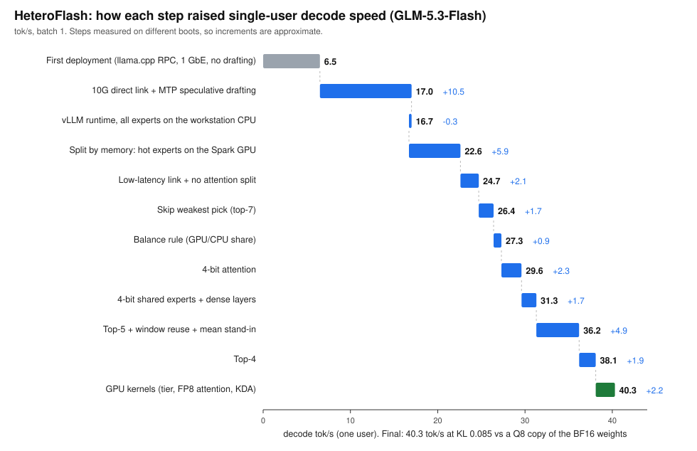
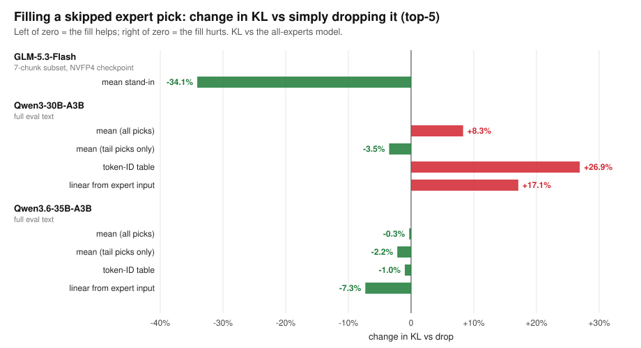

# HeteroFlash

**Serving MoE models interactively on constrained hardware**

## Why this matters

Frontier open models are now huge mixture-of-experts (MoE) models. Each token only uses a few of the model's experts,
so they are cheap to *run*, but every expert must sit in fast memory, so they are expensive to *hold*. The usual
answers are more GPUs, or compressing the model so hard (e.g. to 2 bits) that its answers get noticeably worse.

HeteroFlash takes a third route: it treats the model and modest hardware as one design problem (what to keep on the
GPU, what to compute on a CPU next to its own memory, at what precision, and which work to skip) and measures every
choice against the full model's quality.

## What we achieved

HeteroFlash runs **GLM-5.3-Flash, a 320-billion-parameter MoE model, at 42.7 tokens/s for one user on one DGX Spark
plus an ordinary workstation's CPU**. The usual way to fit this model on a Spark, compressing its experts to 2 bits, runs
at 27.5 tokens/s. HeteroFlash is **55% faster and stays 2.4x closer to the full model** (KL divergence 0.0996 vs 0.239;
"full model" = the official released weights, measured against a near-lossless 8-bit copy). A quality setting reaches
KL 0.073 (3.3x closer) at about 38 tokens/s.

Hover descriptions: open the chart directly ([frontier.svg](https://raw.githubusercontent.com/whitebadlabs/HeteroFlash/main/docs/frontier.svg)).

| | decode speed, 1 user | KL to the full model (lower is better) |
|---|---|---|
| **HeteroFlash (top-3 + 2 late), fastest** | **42.7 tok/s** | **0.0996** |
| HeteroFlash (top-4 + 2 late) | 38.4 tok/s | 0.073 |
| HeteroFlash (top-4) | 40.3 tok/s | 0.085 |
| HeteroFlash (top-5) | 36.2 tok/s | 0.065 |
| HeteroFlash (top-6) | 34.3 tok/s | 0.057 |
| Standard 2-bit build, all on the Spark | 27.5 tok/s | 0.239 |

top-k = experts kept per token out of 8; + 2 late = the next two experts are computed by the workstation and added one
layer later; top-6/top-5 were measured before the GPU kernel work, so they would be somewhat faster today.

### Why the quality gap matters

- KL measures how far the model's next-token probabilities drift from the full model. The standard 2-bit build drifts
  2.4x more than the fastest HeteroFlash setting (KL 0.239 vs 0.0996) and 3.3x more than the quality setting (0.073).
- Its top choice disagrees with the full model on 15.1% of tokens (top-1 agreement 84.9%), against 10.0% for the fastest
  HeteroFlash setting (90.0%), 8.5% for the quality setting (91.5%) and 7.2% for top-6 (92.8%).
- Tool calling at the fastest setting scored 90/100, against 89 for the model with all experts (and 88 for top-4 on the
  same server boot).
- More speed usually costs quality on fixed hardware; here both improve at once. For scale, a two-GPU workstation
  server running the model at 3.5 bits reaches KL 0.042; HeteroFlash top-6 (0.057) comes close without any GPU on the
  workstation.

## Key levers

Every decoded token costs the same thing: read the weights it needs, then compute. On hardware that cannot hold the whole
model in fast memory, that leaves four levers, and HeteroFlash pulls all four at once:

1. **Where each expert runs: compute it where its weights live.** The Spark GPU keeps the frequently used ("hot")
   experts. Every other expert stays in the workstation's RAM and is *computed there by its CPU*, at the same time as
   the GPU works. Only small activations cross the 10G link, never weights, so both memories are read in parallel.
2. **How many bits each weight needs: fewer bits where it is safe.** Each part of the model gets its own precision, set
   by how often it is read and how much quality it carries:
   - routed experts (most of the model's size): 4-bit Q4_K, about 4.5 bits per weight with its scales, quantized with
     an importance matrix and identical on both machines;
   - attention, shared experts and dense layers (read by every token): 4-bit NVFP4, down from FP8;
   - output head: 8-bit MXFP8.

   Going lower on the experts, to 2 bits, is the usual way to fit the model on one Spark; it costs 3.7x more quality
   than the top-5 point.
3. **Which expert work is worth doing: skip what barely matters, reuse what is already loaded.** A token's 8 routed
   experts are not equally important. The strongest picks are always computed; the weakest are replaced by the
   expert's average output instead of being dropped. Speculative decoding checks 4 tokens at once, so a skipped pick is
   kept for free when its expert is already being read for another token in the same window.
4. **When each piece of work has to finish: let weak picks arrive late, speed up the critical path.** GPU and CPU work
   overlap and the link is tuned for latency. The fastest setting computes the 3 strongest picks on time and lets the
   workstation compute the next 2 and add them one layer later, so the GPU does not wait for them. Three custom GPU
   kernels shorten the critical path, and speculative decoding commits about 2.9 tokens per step.

The yardstick for every change is two numbers: decode speed, and quality measured per domain against a Q8 copy of the
official BF16 weights. A change is kept only if it moves the speed-quality frontier.

## From 6.5 to 42.7 tok/s

How to read this: each row is a cumulative step that adds one change on top of all the rows above it. The rows were
measured on different days and on slightly different workloads ([technical report](paper/heteroflash.pdf), section 6.3, has
the details), so the increments are
approximate, not a clean ablation.

| step | what this step means | decode tok/s | KL |
|---|---|---|---|
| first deployment | Off-the-shelf llama.cpp splitting the model's layers between the two machines over a 1 GbE link, no speculative decoding | 6.5 | |
| + 10G link + MTP speculative drafting | A faster cable, and the model's built-in draft head guesses 3 tokens ahead that the full model then checks in one pass | 17.0 | |
| + vLLM runtime, all experts on the workstation CPU | Switched to our own vLLM-based runtime. About the same speed, but it is the base that allows the later GPU/CPU split | 15-18 (16.7 average) | |
| + split by memory | Hot experts computed on the Spark GPU, the rest on the workstation CPU next to its RAM | 22-23 | 0.027 |
| + low-latency link tuning | Link power-saving and interrupt batching off; attention no longer split across the machines | 24.7 | 0.027 |
| + skip the weakest pick (top-7) | Each token uses 7 of its 8 experts | 26.4 | 0.038 |
| + balance rule | Decides per step how many experts the GPU takes and how many the CPU takes | 27.3 | 0.038 |
| + 4-bit attention | Attention weights in 4 bits (NVFP4) instead of 8 | 29.6 | 0.052 |
| + 4-bit shared experts and dense layers | The same for the parts every token always uses | 31.3 | about unchanged |
| + top-5, window reuse, mean stand-in | 5 of 8 experts; a skipped pick is kept if its expert is already loaded for a nearby token; the rest are replaced by the expert's average output | 36.2 | 0.065 |
| + top-4 | 4 of 8 experts | 38.1 | 0.085 |
| + GPU kernel work | Three faster GPU programs: a parallel tier kernel (decides per layer which expert runs where), FP8 weights + a custom kernel for the DSA attention step, and a custom kernel for the KDA attention projections | 40.3 | 0.085 |
| + late weak picks (top-3 on time + 2 late) | The 3 strongest experts on time; the 4th and 5th are computed by the workstation and added one layer later, so the GPU does not wait for them | **42.7** (+2.4) | **0.0996** |

Where each 72-76 ms top-4 step went: about 85% is Spark GPU work (attention, the GPU-resident experts, the draft head).
The GPU waits on the workstation only about 11 ms per step, the workstation CPU is about 40% busy, and the network is
19% of each round trip. The last step uses that spare workstation time: one pick fewer on time, two late picks on the
workstation, 69 ms per step.

## How the headline numbers were measured

| setting | speed (tok/s) | KL | top-1 | tool calling | worst domain |
|---|---|---|---|---|---|
| top-3 + 2 late | 42.7 | 0.0996 | 90.0% | 90/100 | instruction following 0.137 |
| top-4 + 2 late | 38.4 | 0.073 | 91.5% | not run | knowledge QA 0.102 |
| top-4 | 40.3 | 0.085 | 90.8% | 88-89/100 | instruction following 0.132 |
| top-5 | 36.2 | 0.065 | 92.1% | 90/100 | instruction following 0.101 |
| top-6 | 34.3 | 0.057 | 92.8% | – | instruction following 0.086 |
| standard 2-bit build (all on the Spark) | 27-28 | 0.239 | 84.9% | – | – |
| two-GPU server, EXL3 3.5-bit | 151 | 0.042 | 94.0% | – | – |

- Speed: median of interleaved rounds on the same server boot; single user, batch 1, speculative decoding.
- Quality: 42K tokens across 7 domains, KL against a Q8 copy of the official BF16 weights. The all-experts baseline
  scored 89/100 on tool calling.
- Quality bar: KL at most 0.10, no domain above 0.15, tool calling at least 87/100. The fastest setting passes with a
  thin margin.
- Boot-by-boot numbers and per-step timings are in the [technical report](paper/heteroflash.pdf) (sections 5-6).

## What worked and what didn't

For each lever we tried every idea we could find, from papers, public repos and our own traces. A change was kept only
if it made decoding faster without crossing the quality bar. Here is the full list, grouped by lever, including what we
rejected.

All measured unless marked simulated or modeled. Speeds are GLM-5.3-Flash on 1 DGX Spark + workstation CPU/RAM, batch 1.
Quality is KL divergence to a Q8 copy of the official BF16 weights (lower is better; 0.1 is the go/no-go bar).

| method | what it does | result | impact |
|---|---|---|---|
| **1. Where each expert runs** | | | |
| Split by memory ([Fiddler](https://arxiv.org/abs/2402.07033), Kamahori et al., 2024; [KTransformers](https://github.com/kvcache-ai/ktransformers); two-machine design: this project) | The Spark GPU computes the frequently used experts; every other expert is computed by the workstation's CPU right next to its own RAM, so only small activations cross the network, never weights | ✅ worked | 15-18 → 22-23 tok/s, lossless (KL 0.027) |
| Low-latency link (standard practice) | Turns off power-saving and interrupt batching on the 10G link, and stops splitting attention across machines, so each round trip takes under 1 ms | ✅ worked | → 24.7 tok/s, lossless |
| Balance rule (this project) | Decides per step how many experts the GPU takes vs the CPU, so neither machine sits idle waiting for the other | ✅ worked | 26.4 → 27.3 tok/s, same quality |
| Grouping co-selected experts on one GPU (this project; the inverse of Insight 5 in [Patterns behind Chaos](https://arxiv.org/abs/2510.05497), ISCA 2026, which advises spreading them) | On multi-GPU servers, puts experts that are often picked together on the same GPU to cut traffic | ❌ failed (simulated), as that paper's Insight 5 predicts | 9-21% fewer cross-GPU sends on 5 models, but GPU load becomes less even |
| Per-batch copies of hot experts ([MegaFlux](https://arxiv.org/abs/2610.00671), 2026) | Duplicates busy experts on several GPUs to restore balance | ⚠️ works only with current-batch routing (simulated) | with the current batch's routing it restores balance, as MegaFlux does; planners that only see past batches missed the balance limit in every cell |
| Per-request hot set ([Patterns behind Chaos](https://arxiv.org/abs/2510.05497)) | Uses the prompt's routing to choose which experts the GPU holds for that request | ⚠️ marginal here | GPU coverage 54.6% → 67-69%, modeled speed +0-2% (the GPU already holds more needed experts than it has time to compute) |
| Moving more experts to the workstation (balance-rule sweep, this project) | Shifts the balance rule so the half-idle workstation CPU takes a larger share of each step's experts | ❌ slower | GPU share 50%: 77 ms per step; 40%: 81; 30%: 84; 20%: 89. Today's split is best. A smaller KV reserve with a larger 132-expert GPU pool: no gain either |
| Next-layer weight prefetch (MoE-Infinity style; simulated on 5 models) | Predicts the next layer's experts and streams their weights to the GPU ahead of time, instead of computing misses on the CPU | ❌ failed (simulated) | Cuts misses only 3-34%; for one user over a PCIe-class link the stall gets worse, because wrong guesses also cost transfer time |
| Split retuned for several users (this project) | With more than one stream, sends a larger share of experts to the workstation, which handles big batches better than the Spark's expert kernel | ✅ worked | 4 users, top-4: 28.2 → 50.5 tok/s total; 2 users: 39.6 → 47.6 |
| **2. How many bits each weight needs** | | | |
| 4-bit attention ([NVFP4](https://github.com/NVIDIA/TensorRT-Model-Optimizer), NVIDIA; converter: this project) | Stores the attention weights in 4 bits instead of 8, so each step reads fewer bytes | ✅ worked | 27.3 → 29.6 tok/s, KL +0.014 |
| 4-bit shared experts and dense layers (NVFP4) | Same for the parts every token always uses | ✅ worked | → 31.3 tok/s (top-7), quality about unchanged |
| 2-bit routed experts, all on the Spark (IQ2_XXS, [llama.cpp](https://github.com/ggml-org/llama.cpp)) | The usual way to fit the model on one Spark: shrink every expert to 2 bits | ❌ quality cost too high | 27-28 tok/s at KL 0.239 |
| FP8 weights + custom GEMV for the DSA attention absorb step (this project) | Stores the kv_b weights of the 11 DSA attention layers in 8 bits (MXFP8) instead of BF16 and runs them with a kernel written for 1-4 tokens | ✅ worked | ~2.1 ms per step faster, KL +0.0006 |
| EXL3 3.5-bit GPU experts, Q4_K kept on the workstation ("two weight sets"; [exllamav3](https://github.com/turboderp-org/exllamav3) kernels ported to the Spark) | Smaller, faster copies of the GPU-resident experts | ⚠️ works, too small a gain | GPU expert time −40%, but only +3.8% overall because each step waits on the workstation; KL +0.006 |
| **3. Which expert work is worth doing** | | | |
| Rank rule, top-7 of 8 ([K3.1 sensitivity study](https://github.com/chronarion/derpk31pro/tree/main/docs/sensitivity)) | Each token picks 8 experts; the weakest one contributes least, so it is skipped | ✅ worked | 24.7 → 26.4 tok/s, KL 0.027 → 0.038 |
| Window-level expert reuse ([Lynx](https://arxiv.org/abs/2411.08982), Gupta et al., 2024) + mean-output stand-in ([K3.1 study](https://github.com/chronarion/derpk31pro/tree/main/docs/sensitivity)), top-5 | Speculative decoding checks 4 tokens at once; a skipped pick is kept anyway if its expert is already being read for another token in the window (free). Picks that are still skipped are replaced by that expert's average output instead of nothing | ✅ worked | 31.3 → **36.2 tok/s at KL 0.065** (reuse alone: 33.2 tok/s at 0.083) |
| Window-level expert reuse on 6 models ([Lynx](https://arxiv.org/abs/2411.08982), applied to single-user speculative windows) | The same reuse rule, tested on Qwen, GLM and gpt-oss models | ✅ worked | 13-39% less quality loss at the same expert reads; GSM8K at top-2 (Qwen3.6-35B): 91.1% → 93.9%. Plain top-3 matches reuse at top-2, so the gain is fewer expert reads, not accuracy per expert computed |
| Mean-output stand-in on Qwen3-30B ([K3.1 study](https://github.com/chronarion/derpk31pro/tree/main/docs/sensitivity)) | The average-output replacement on a different model | ❌ did not transfer | neutral to worse; [why](#why-the-mean-output-stand-in-does-not-transfer-to-qwen) |
| Co-selection-guided substitution (this project) | Replaces a skipped expert with its usual partner expert | ❌ failed | worse than reuse alone and than random controls |
| 2-bit fallback tier (this project) | Computes weak picks from 2-bit copies on the Spark GPU instead of the average output | ⚠️ quality yes, speed no | Full-eval KL 0.066 → 0.053 (every domain better), but 11-17% slower: the Spark GPU has no spare time once the workstation wait is gone |
| Truncated-expert fallback (this project) | For skipped weak picks, computes a cut-down copy of the expert (its top 256 or 512 of 2,048 neurons, output layer refitted) instead of the average output | ⚠️ quality yes, speed no | Full-eval KL 0.0856 → 0.0783 (−0.0073) at −2.6% speed; top-3 + truncated is not faster than top-4. Below the bar we set (−0.01 KL) |
| Smarter fills for skipped picks (offline study, this project) | Router-score predictor, co-active prediction, shared base + residual, output memoization, width-64 surrogates, linear fill from the expert's input | ❌ failed (offline) | None beat the plain mean by enough on GLM to be worth building |
| Per-expert fallback budget (this project) | Chooses the fallback for each of the 12,096 (layer, expert) pairs instead of one rule per layer | ✅ finding (offline) | Experts within a layer differ 8-9x more than layers do; at the same memory a per-expert budget leaves 13-18% less error. Also found and fixed early-token outliers in the average-output table (no measurable KL change) |
| **4. When each piece of work has to finish** | | | |
| Parallel tier kernel (this project) | The per-layer GPU decision of which expert runs where used one GPU thread looping over all 288 experts; it now uses one thread per expert. It sits ahead of every workstation exchange, so its time is on the critical path | ✅ worked | 38 µs → 3.7 µs per layer, ~1.9 ms per step; output identical (checked on 59,808 live decode windows) |
| Custom GEMV for the KDA attention projections (this project) | Runs the existing 4-bit (NVFP4) linear-attention projections with a kernel written for 1-4 tokens instead of a general GEMM | ✅ worked | ~1.2 ms per step, lossless (same weight bytes) |
| Whole-partial deferral (this project; a coarser form of [derpseek](https://github.com/chronarion/derpseek)'s `deferred-fast`, which defers one missed expert a sublayer) | Lets the GPU continue without waiting for the CPU's whole result, adding it one layer late | ❌ quality failed | 32-33 tok/s but KL 0.44 |
| Weak picks one layer late ([K3.1 study](https://github.com/chronarion/derpk31pro/tree/main/docs/sensitivity); close to [derpseek](https://github.com/chronarion/derpseek)'s `deferred-fast`) | The 3 strongest picks are computed on time; the 4th and 5th are computed by the workstation and added one layer later, so the GPU does not wait for them | ✅ worked | +7.6-8.2% over top-4 on the same boot (42.7 vs 39.7 tok/s) at KL 0.0996, tool calling 90/100. An earlier test (22-24 tok/s) failed only because the workstation's page cache was thrashing. Delaying all 4 weak picks still fails (−19%): the workstation gets swamped. Top-4 + 2 late: KL 0.073 at −4% |
| Longer drafts, MTP-4 ([speculative decoding](https://arxiv.org/abs/2211.17192), Leviathan et al., 2023) | Guesses 4 tokens ahead per step instead of 3 | ❌ no gain | 2.98 vs 2.92 tokens committed per step, but 95 vs 73 ms per step: ~31 vs 40.3 tok/s. Shorter MTP-2 vs MTP-3: 41.0 vs 40.3 tok/s, a tie (within 2%) |
| Smaller draft vocabulary ([FR-Spec](https://arxiv.org/abs/2502.14856)) | The draft head scores only the ~20K most frequent tokens instead of the full vocabulary | ❌ slower | −4 ms per step, but accepted tokens drop from 2.84 to 2.40 per step: about −10% tok/s |

**Net:** 6.5 tok/s (first deployment) → 42.7 tok/s at KL 0.0996 (or 38.4 tok/s at KL 0.073 in the quality setting).
The usual 2-bit single-Spark build runs 27-28 tok/s at
KL 0.239.

## Several users at once

Concurrency (C) = 1, 2, 4 users at once, top-4: **36.7 / 47.6 / 50.5 tok/s in total**, measured before the GPU
kernel work. More than 4 concurrent users currently fall back to a slower path, so C = 8 or 10 is not measured.

Setup: 8 prompts of 512 tokens per run, about 100 runs per setting (`results/2026-11-21-multistream/`).

| concurrency (C) | total tok/s | per user | GPU share of each step's experts |
|---|---|---|---|
| 1 | 36.7 | 36.7 | 50% |
| 2 | 47.6 | ~24 | 35% |
| 4 | 50.5 | ~12.6 | 15% |

- With the single-user split (GPU takes half), 4 users were slower in total than one (28.2 tok/s). The Spark's expert
  kernel re-reads each expert's weights for every group of 4 tokens, so its cost grows with the number of users, while
  the workstation handles big batches well. Moving more of the work to the workstation fixes most of it.
- Different users share few experts: distinct experts per layer grow from about 12 (1 user) to 41 (4 users).
- Quality does not depend on the split: it only moves the same Q4_K experts between the two machines. Tool calling ran
  4 conversations in parallel and scored 89/100.
- Limits: the split is set by hand per user count, and a step with more than 16 tokens (more than 4 users, or a new
  prompt's prefill landing next to running decodes) falls back to a slower all-workstation path.

## Union-aware routing on other models

**The method.** Speculative decoding verifies several tokens at once (here a window of 4). Each token's router picks
its experts; with a reduced budget only its top-K picks are computed. Union-aware routing adds one rule: a weaker
pick beyond the top-K is still kept if its expert is already being read for another token in the same window. That
expert's weights are loaded anyway, so keeping the pick costs no extra memory reads. It builds on the batch-aware expert selection of [Lynx](https://arxiv.org/abs/2411.08982) (Gupta et al., 2024),
which shares experts across concurrent requests in a batch. That does nothing for a single user at batch 1, the
interactive case. Applying the same idea inside one request's speculative-decoding verify window brings the saving to
single-user serving, and we measure it on six MoE models from three families (Qwen, GLM, gpt-oss), 30B to 320B-class.

**The measurement.** Quality cost = full-vocabulary KL divergence to the unmodified model (all experts) on the same
text. For each model we use fewer experts per token two ways, plain (drop everything below the top-K) and union-aware,
at the same number of expert reads. Teacher-forced, 128-token chunks of a 7-domain eval set (168 chunks per model),
vLLM on 2 RTX PRO 6000 Max-Q GPUs.

"Less damage" = 1 - (union KL / plain KL): the share of the quality loss from dropping experts that union routing removes.

| model | experts, top-k | union / plain (top-6 / 5 / 4) | less damage with union | union better on |
|---|---|---|---|---|
| Qwen3-30B-A3B | 128, top-8 | 0.64 / 0.63 / 0.61 | 36% / 37% / 39% | 162-165 of 168 chunks |
| Qwen3.6-35B-A3B | 256, top-8 | 0.72 / 0.69 / 0.68 | 28% / 31% / 32% | 155-166 of 168 |
| gpt-oss-120b | 128, top-4 | 0.68 (top-3) / 0.74 (top-2) | 32% / 26% | 151 / 147 of 168 |
| GLM-4.5-Air (106B) | 128, top-8 | 0.78 / 0.71 / 0.70 | 22% / 29% / 30% | 149-162 of 168 |
| Qwen3.8-Flash-Next (180B) | 512, top-10 | 0.87 / 0.80 / 0.78 (top-8 / 6 / 5) | 13% / 20% / 22% | 136-160 of 168 |

- Union adds at most 0.05 expert reads per 4-token window, so speed is unchanged.
- Union helps on every model, but the size varies: 30-40% less quality loss on Qwen3-30B, Qwen3.6-35B and gpt-oss-120b,
  13-30% on GLM-4.5-Air and Qwen3.8-Flash-Next. The gain tracks how many dropped picks the window recovers
  (42% of them on Qwen3-30B, 23-34% on the others); models with more experts share fewer experts between neighbouring
  tokens. Size, expert count, family and quantization change together across these models, so no single cause is isolated.
- gpt-oss-120b is measured at 128 tokens only: its long-context path gave unusable reference outputs in this vLLM
  build on these GPUs.
- In the HeteroFlash runtime itself (GLM-5.3-Flash, 288 experts; different setup and eval chunks, so not directly
  comparable), union routing removed 24% / 24% / 31% of the loss at top-6 / 5 / 4.
- Every reference run through the hook reproduces the unmodified model exactly (KL 0); deterministic MoE kernels are
  used where the default kernels varied between identical runs. Details and files: `results/2026-11-19-union-large/`.
- In progress: Inkling-2-Small (~594B), DeepSeek-V4.1-Flash.

## Why the mean-output stand-in does not transfer to Qwen

On GLM-5.3-Flash, replacing a skipped pick with its routing weight times the expert's average output roughly halves
the cost of skipping it. On Qwen3-30B-A3B it makes things slightly worse, and on Qwen3.6-35B-A3B it does nothing. We
tested why, and whether richer fills do better (`results/2026-11-19-token-fill/`).

- **On Qwen, a skipped expert's output is mostly input-dependent, not a steady offset.** Outside the last layer, any
  fixed vector can remove at most about 7-8% of the skip error (in-sample ceiling). A mean has little to work with.
- **The plain mean is also skewed.** It is averaged over all picks, and in early layers a few very large outputs (the
  first token of each sequence, top-ranked picks) dominate it. In layer 2 of Qwen3-30B this makes the error 131% worse
  than dropping. A mean fitted only on the weak picks that actually get skipped fixes this: KL 3.5% better than drop on
  Qwen3-30B and 2.2% on Qwen3.6-35B.
- **A token-ID table does not help.** Keyed on the current token (the "token row" idea), it covers only 50-54% of the
  skipped weight with enough samples, overfits where it does, and loses to the mean: +27% KL vs drop on Qwen3-30B.
  Even when we fit the table only on skipped picks, it only ties the weak-pick mean.
- **Only the expert's own input explains part of the spread.** A rank-32 linear correction from it removes 7-11% of the
  skip error outside the last layer and is the best fill on Qwen3.6-35B (KL 7.3% better than drop). On Qwen3-30B it
  hurts overall, because of one layer (layer 1).

Caveats: Qwen models only (our GLM traces have no token IDs or router weights); about 104K calibration tokens; GPU
accumulation order makes the fits vary slightly, so KL differences of 1-2% are ties.

## Takeaways

- **On constrained hardware, co-design beats any single trick.** Past the first working system, each change gave roughly 5-25%.
  Together they took it from 6.5 to 42.7 tok/s.
- **Not all expert computation is equal.** Ranking expert work by contribution, and approximating instead of
  dropping, buys speed at a fraction of the usual quality cost.
- **Quality is a dial, not a cliff.** The frontier runs from near-reference quality (KL 0.038 at 27 tok/s) to
  42.7 tok/s at KL 0.0996, just inside the 0.1 bar, and every point is measured, not assumed.
- **Once the workstation wait is mostly hidden, the Spark GPU sets the pace.** Small kernels on the critical path (a
  control kernel and attention projections) bought about 7%. That kernel work is specific to GLM-5.3-Flash's attention
  layout and to the Spark.
- **Spare workstation time can carry the weak picks.** Computing the 4th and 5th picks on the workstation one layer late
  bought another 7.6-8.2%. Delaying more of them swamps the workstation and costs 19%.
- **Not lossless, and not yet at the original GPU server's speed (151 tok/s).** Single user, batch 1. Tool calling on
  GLM-5.3-Flash matched the all-experts baseline (90/100 at top-3 + 2 late and at top-5, 88-89/100 at top-4, vs
  89/100), and math (GSM8K) was
  checked for the routing technique on Qwen3.6-35B.
  Math and knowledge scores on GLM itself, and time-to-first-token on long prompts, are the next measurements.

## Technical report

The full technical write-up is a LaTeX technical report: [paper/heteroflash.pdf](paper/heteroflash.pdf) (source:
[paper/heteroflash.tex](paper/heteroflash.tex)). It covers the problem and hardware, the system design (expert
placement and the in-graph mailbox exchange), the methods with their formulas (balance rule, top-k truncation,
union-aware routing, mean-output stand-in, late weak picks, quality metrics and bars), the evaluation protocol, every
measurement with its source file, twelve labelled findings including the negative results, limitations, and how to
reproduce the results.

## References

Sources of the techniques used (also credited inline in "What worked and what didn't"):
- CPU expert computation: Fiddler (arXiv 2402.07033), KTransformers, HybriMoE
- Hot-expert offloading: Mixtral offloading (arXiv 2312.17238), MoE-Infinity, HOBBIT (arXiv 2411.01433)
- NVFP4 formats and Spark kernels: NVIDIA ModelOpt; Local Inference Lab's vLLM fork and b12x
- Q4_K experts and importance matrix: llama.cpp / ggml
- Speculative decoding: arXiv 2211.17192, arXiv 2302.01318; FR-Spec draft vocabulary (arXiv 2502.14856)
- Rank-based expert budget, mean-output stand-in, late weak picks: [Kimi K3.1 sensitivity study](https://github.com/chronarion/derpk31pro/tree/main/docs/sensitivity), [derpseek](https://github.com/chronarion/derpseek)
- Window-level expert reuse: [Lynx](https://arxiv.org/abs/2411.08982) (batch-aware expert selection)
- Co-selection and routing patterns: "Patterns behind Chaos" (arXiv 2510.05497), ExFlow (arXiv 2401.08383); MegaFlux (arXiv 2610.00671)
- Expert load balancer: vLLM DefaultEplbPolicy / DeepSeek EPLB
- Benchmarks: llm-inference-bench (Local Inference Lab), tool-eval-bench

## License and data

Code: Apache-2.0, see [LICENSE](LICENSE). Copyright 2026 Whitebad Labs. Results, routing traces and other data in this
repository: CC-BY-4.0, Copyright 2026 Whitebad Labs (reuse freely, with attribution). No model weights are redistributed here; the official GLM-5.3-Flash model
card lists the weights as MIT. Evaluation and calibration text comes from public datasets and public encyclopedia text
under their own licenses (`results/2026-11-08-balanced-eval/q_eval_balanced_v1.manifest.json`).
