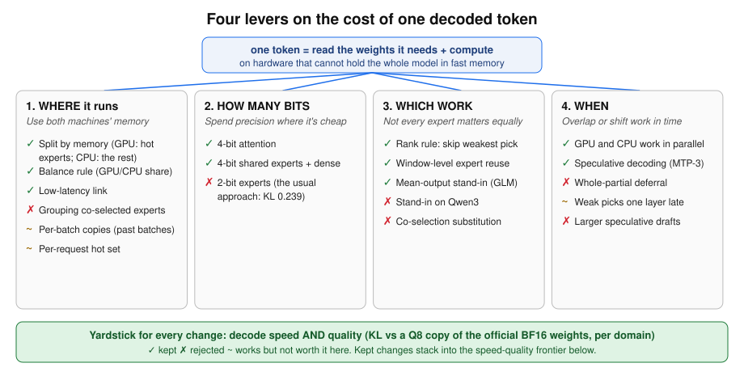
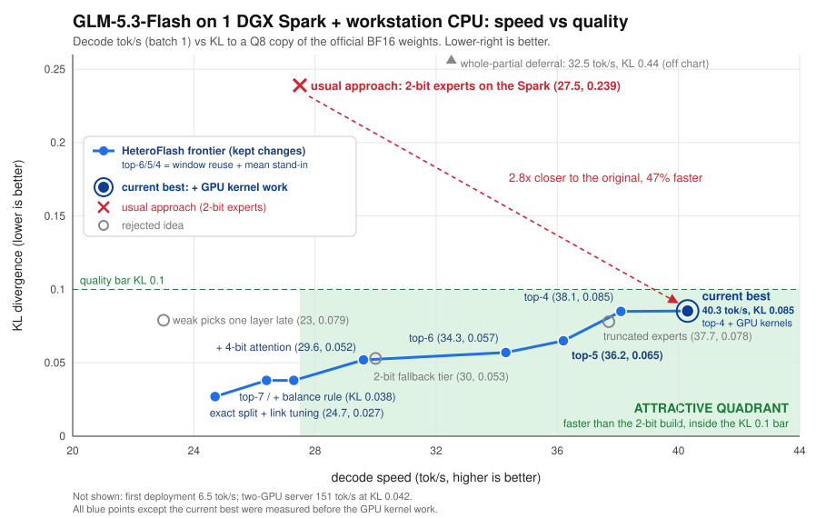

# HeteroFlash

**Serving MoE models interactively on constrained hardware**

## Why this matters

Large mixture-of-experts (MoE) models are cheap to *run* per token, because each token only uses a few of the model's
experts, but expensive to *hold*: every expert has to sit in fast memory. The usual answers are more GPUs, or
quantizing the model so hard that its answers get noticeably worse.

HeteroFlash takes a third route. It treats the model and the hardware as one design problem: what to keep on the
GPU, what to compute on a CPU next to its own RAM, at what precision, and which work to skip, approximate or postpone.
Every one of those choices is measured against the original model's quality.

**Result:** on one DGX Spark plus a workstation's CPU and RAM, GLM-5.3-Flash runs at **34-36 tok/s** and stays close
to the original model (KL 0.057-0.065 vs a Q8 copy of the official BF16 weights). The usual way to fit it on the same Spark, crushing the experts to 2 bits, is
both slower and 3.7x further from the original.

Decode speed and quality against the original model (KL divergence to a Q8 copy of the official BF16 weights; lower is better):

| model | hardware | HeteroFlash (balanced) | HeteroFlash (fastest) | best existing quantization that fits the same hardware |
|---|---|---|---|---|
| GLM-5.3-Flash (320B-class MoE) | 1 DGX Spark + a workstation's CPU and RAM (no workstation GPU) | **34.3 tok/s, KL 0.057** (top-1 92.8%, every domain within 0.1) | **36.2 tok/s, KL 0.065** (top-1 92.1%) | 2-bit experts (IQ2_XXS), all on the Spark: 27-28 tok/s, KL 0.239 (top-1 84.9%) |

Also measured on the same system: top-4 at **38.1 tok/s, KL 0.085** (top-1 90.7%; instruction following 0.134, so
outside 0.1 in that one domain). The expert-routing technique is also measured on five more MoE models (Qwen3-30B,
Qwen3.6-35B, gpt-oss-120b, GLM-4.5-Air, Qwen3.8-Flash-Next); see [Union-aware routing on other models](#union-aware-routing-on-other-models) below. For scale, the same GLM model on a two-GPU workstation server (3.5-bit EXL3, tensor parallel 2) runs
151 tok/s at KL 0.042, and this runtime with all experts on the CPU and none of the techniques runs 15-18 tok/s.

Single user, batch 1, speculative decoding. Quality is measured on 42K tokens across 7 domains (writing, knowledge,
math, code, multilingual, instruction following, long context). Tool calling (tool-eval-bench, leaderboard settings):
HeteroFlash's fastest point matched the all-8-experts baseline (90/100 vs 89/100, within run-to-run noise).

## How it works: four levers

Every decoded token costs the same thing: read the weights it needs, then compute. On hardware that cannot hold the whole
model in fast memory, that leaves four levers, and HeteroFlash pulls all four at once:

1. **Where each expert runs.** The Spark GPU keeps the frequently used ("hot") experts. Every other expert stays in
   the workstation's RAM and is *computed there by its CPU*, at the same time as the GPU works. Only small activations
   cross the 10G link, never weights, so both memories are read in parallel.
2. **How many bits each weight needs.** Each part of the model gets its own precision, set by how often it is read
   and how much quality it carries:
   - routed experts (most of the model's size): 4-bit Q4_K, about 4.5 bits per weight with its scales, quantized with
     an importance matrix and identical on both machines;
   - attention, shared experts and dense layers (read by every token): 4-bit NVFP4, down from FP8;
   - output head: 8-bit MXFP8.

   Going lower on the experts, to 2 bits, is the usual way to fit the model on one Spark; it costs 3.7x more quality.
3. **Which expert work is worth doing.** A token's 8 routed experts are not equally important. The strongest picks are
   always computed; the weakest are skipped and replaced by the expert's average output. In speculative decoding, a
   skipped pick is kept anyway when its expert is already being read for another token in the same window, since
   that costs nothing.
4. **When each piece of work has to finish.** GPU and CPU work overlap, the link is tuned for latency, and speculative
   decoding commits about 2.9 tokens per step.

The yardstick for every change is two numbers: decode speed, and quality measured per domain against a Q8 copy of the
official BF16 weights. A change is kept only if it moves the speed-quality frontier.

## What worked and what didn't

For each lever we tried every idea we could find, from papers, public repos and our own traces. A change was kept only
if it made decoding faster without crossing the quality bar. Here is the full list, grouped by lever, including what we
rejected.

All measured unless marked simulated or modeled. Speeds are GLM-5.3-Flash on 1 DGX Spark + workstation CPU/RAM, batch 1.
Quality is KL divergence to a Q8 copy of the official BF16 weights (lower is better; 0.1 is the go/no-go bar).

| method | what it does | result | impact |
|---|---|---|---|
| **1. Where each expert runs** | | | |
| Split by memory ([Fiddler](https://arxiv.org/abs/2402.07033), Kamahori et al., 2024; [KTransformers](https://github.com/kvcache-ai/ktransformers); two-machine design: this project) | The Spark GPU computes the frequently used experts; every other expert is computed by the workstation's CPU right next to its own RAM, so only small activations cross the network, never weights | ✅ worked | 15-18 → 22-23 tok/s, lossless (KL 0.027) |
| Low-latency link (standard practice) | Turns off power-saving and interrupt batching on the 10G link, and stops splitting attention across machines, so each round trip takes under 1 ms | ✅ worked | → 24.7 tok/s, lossless |
| Balance rule (this project) | Decides per step how many experts the GPU takes vs the CPU, so neither machine sits idle waiting for the other | ✅ worked | 26.4 → 27.3 tok/s, same quality |
| Grouping co-selected experts on one GPU (this project; the inverse of Insight 5 in [Patterns behind Chaos](https://arxiv.org/abs/2510.05497), ISCA 2026, which advises spreading them) | On multi-GPU servers, puts experts that are often picked together on the same GPU to cut traffic | ❌ failed (simulated), as that paper's Insight 5 predicts | 9-21% fewer cross-GPU sends on 5 models, but GPU load becomes less even |
| Per-batch copies of hot experts ([MegaFlux](https://arxiv.org/abs/2610.00671), 2026) | Duplicates busy experts on several GPUs to restore balance | ⚠️ works only with current-batch routing (simulated) | with the current batch's routing it restores balance, as MegaFlux does; planners that only see past batches missed the balance limit in every cell |
| Per-request hot set ([Patterns behind Chaos](https://arxiv.org/abs/2510.05497)) | Uses the prompt's routing to choose which experts the GPU holds for that request | ⚠️ marginal here | GPU coverage 54.6% → 67-69%, modeled speed +0-2% (the GPU already holds more needed experts than it has time to compute) |
| **2. How many bits each weight needs** | | | |
| 4-bit attention ([NVFP4](https://github.com/NVIDIA/TensorRT-Model-Optimizer), NVIDIA; converter: this project) | Stores the attention weights in 4 bits instead of 8, so each step reads fewer bytes | ✅ worked | 27.3 → 29.6 tok/s, KL +0.014 |
| 4-bit shared experts and dense layers (NVFP4) | Same for the parts every token always uses | ✅ worked | → 31.3 tok/s (top-7), quality about unchanged |
| 2-bit routed experts, all on the Spark (IQ2_XXS, [llama.cpp](https://github.com/ggml-org/llama.cpp)) | The usual way to fit the model on one Spark: shrink every expert to 2 bits | ❌ quality cost too high | 27-28 tok/s at KL 0.239 |
| **3. Which expert work is worth doing** | | | |
| Rank rule, top-7 of 8 ([K3.1 sensitivity study](https://github.com/chronarion/derpk31pro/tree/main/docs/sensitivity)) | Each token picks 8 experts; the weakest one contributes least, so it is skipped | ✅ worked | 24.7 → 26.4 tok/s, KL 0.027 → 0.038 |
| Window-level expert reuse ([Lynx](https://arxiv.org/abs/2411.08982), Gupta et al., 2024) + mean-output stand-in ([K3.1 study](https://github.com/chronarion/derpk31pro/tree/main/docs/sensitivity)), top-5 | Speculative decoding checks 4 tokens at once; a skipped pick is kept anyway if its expert is already being read for another token in the window (free). Picks that are still skipped are replaced by that expert's average output instead of nothing | ✅ worked | 31.3 → **36.2 tok/s at KL 0.065** (reuse alone: 33.2 tok/s at 0.083) |
| Window-level expert reuse on 6 models ([Lynx](https://arxiv.org/abs/2411.08982), applied to single-user speculative windows) | The same reuse rule, tested on Qwen, GLM and gpt-oss models | ✅ worked | 13-39% less quality loss at the same expert reads; GSM8K at top-2 (Qwen3.6-35B): 91.1% → 93.9%. Plain top-3 matches reuse at top-2, so the gain is fewer expert reads, not accuracy per expert computed |
| Mean-output stand-in on Qwen3-30B ([K3.1 study](https://github.com/chronarion/derpk31pro/tree/main/docs/sensitivity)) | The average-output replacement on a different model | ❌ did not transfer | neutral to worse |
| Co-selection-guided substitution (this project) | Replaces a skipped expert with its usual partner expert | ❌ failed | worse than reuse alone and than random controls |
| **4. When each piece of work has to finish** | | | |
| Whole-partial deferral (this project; a coarser form of [derpseek](https://github.com/chronarion/derpseek)'s `deferred-fast`, which defers one missed expert a sublayer) | Lets the GPU continue without waiting for the CPU's whole result, adding it one layer late | ❌ quality failed | 32-33 tok/s but KL 0.44 |
| Weak picks one layer late ([K3.1 study](https://github.com/chronarion/derpk31pro/tree/main/docs/sensitivity); close to [derpseek](https://github.com/chronarion/derpseek)'s `deferred-fast`) | Delays only the weakest experts by one layer instead of skipping them | ⚠️ quality yes, speed no | KL 0.079 at top-4, but 22-24 tok/s (the CPU side has no spare bandwidth) |
| Larger speculative drafts ([speculative decoding](https://arxiv.org/abs/2211.17192), Leviathan et al., 2023) | Guesses more tokens ahead per step | ❌ no gain | acceptance saturates at ~2.9 tokens per step |

**Net:** 6.5 tok/s (first deployment) → 36.2 tok/s at KL 0.065. The usual 2-bit single-Spark build runs 27-28 tok/s at
KL 0.239.

## Union-aware routing on other models

**The method.** Speculative decoding verifies several tokens at once (here a window of 4). Each token's router picks
its experts; with a reduced budget only its top-K picks are computed. Union-aware routing adds one rule: a weaker
pick beyond the top-K is still kept if its expert is already being read for another token in the same window. That
expert's weights are loaded anyway, so keeping the pick costs no extra memory reads. It builds on the batch-aware expert selection of [Lynx](https://arxiv.org/abs/2411.08982) (Gupta et al., 2024),
which shares experts across concurrent requests in a batch. That does nothing for a single user at batch 1, the
interactive case. Applying the same idea inside one request's speculative-decoding verify window brings the saving to
single-user serving, and we measure it on six MoE models from three families (Qwen, GLM, gpt-oss), 30B to 320B-class.

**The measurement.** Quality cost = full-vocabulary KL divergence to the unmodified model (all experts) on the same
text. For each model we use fewer experts per token two ways, plain (drop everything below the top-K) and union-aware,
at the same number of expert reads. Teacher-forced, 128-token chunks of a 7-domain eval set (168 chunks per model),
vLLM on 2 RTX PRO 6000 Max-Q GPUs.

"Less damage" = 1 - (union KL / plain KL): the share of the quality loss from dropping experts that union routing removes.

| model | experts, top-k | union / plain (top-6 / 5 / 4) | less damage with union | union better on |
|---|---|---|---|---|
| Qwen3-30B-A3B | 128, top-8 | 0.64 / 0.63 / 0.61 | 36% / 37% / 39% | 162-165 of 168 chunks |
| Qwen3.6-35B-A3B | 256, top-8 | 0.72 / 0.69 / 0.68 | 28% / 31% / 32% | 155-166 of 168 |
| gpt-oss-120b | 128, top-4 | 0.68 (top-3) / 0.74 (top-2) | 32% / 26% | 151 / 147 of 168 |
| GLM-4.5-Air (106B) | 128, top-8 | 0.78 / 0.71 / 0.70 | 22% / 29% / 30% | 149-162 of 168 |
| Qwen3.8-Flash-Next (180B) | 512, top-10 | 0.87 / 0.80 / 0.78 (top-8 / 6 / 5) | 13% / 20% / 22% | 136-160 of 168 |

- Union adds at most 0.05 expert reads per 4-token window, so speed is unchanged.
- Union helps on every model, but the size varies: 30-40% less quality loss on Qwen3-30B, Qwen3.6-35B and gpt-oss-120b,
  13-30% on GLM-4.5-Air and Qwen3.8-Flash-Next. The gain tracks how many dropped picks the window recovers
  (42% of them on Qwen3-30B, 23-34% on the others); models with more experts share fewer experts between neighbouring
  tokens. Size, expert count, family and quantization change together across these models, so no single cause is isolated.
- gpt-oss-120b is measured at 128 tokens only: its long-context path gave unusable reference outputs in this vLLM
  build on these GPUs.
- In the HeteroFlash runtime itself (GLM-5.3-Flash, 288 experts; different setup and eval chunks, so not directly
  comparable), union routing removed 24% / 24% / 31% of the loss at top-6 / 5 / 4.
- Every reference run through the hook reproduces the unmodified model exactly (KL 0); deterministic MoE kernels are
  used where the default kernels varied between identical runs. Details and files: `results/2026-11-19-union-large/`.
- In progress: Inkling-2-Small (~594B), DeepSeek-V4.1-Flash.

## Takeaways

- **On constrained hardware, co-design beats any single trick.** Past the first working system, each change gave roughly 5-25%.
  Together they took it from 6.5 to 36 tok/s.
- **Not all expert computation is equal.** Ranking expert work by contribution, and approximating instead of
  dropping, buys speed at a fraction of the usual quality cost.
- **Quality is a dial, not a cliff.** The frontier runs from near-reference quality (KL 0.038 at 26 tok/s) to
  36 tok/s at KL 0.065, and every point is measured, not assumed.
- **Not lossless, and not yet at the original GPU server's speed (151 tok/s).** Tool calling on GLM-5.3-Flash matched the
  all-experts baseline (90/100 vs 89/100), and math (GSM8K) was checked for the routing technique on Qwen3.6-35B.
  Math and knowledge scores on GLM itself, and time-to-first-token on long prompts, are the next measurements.

---

# Full Technical Write-Up

Architecture, methodology, every measurement with its source file, findings (including the ideas that did not work)
and how to reproduce them.

## 1. The problem

GLM-5.3-Flash is a Mixture-of-Experts model: in each of its 42 MoE layers a router picks 8 of 288 routed experts per
token. Only a small part of the model is active per token, but every expert must be readable. At 4 bits the routed
experts alone take about 171-177 GB, more than one DGX Spark (128 GB of unified memory) can hold next to the
attention weights, the KV cache and a draft head.

The question: **can GLM-5.3-Flash run interactively (batch 1, one user) on one DGX Spark, helped only by the CPU and
RAM of an ordinary workstation, at quality no worse than a two-GPU server deployment of the same model?**

Hardware, by role:

| role | hardware | what it does |
|---|---|---|
| GPU node | one DGX Spark (GB10, 128 GB unified LPDDR5X, 273 GB/s rated) | attention, KV cache, a hot subset of experts, the MTP draft head |
| CPU node | a 32-core, 4-chiplet workstation CPU, 8-channel DDR5-5600, ~230 GB free RAM; its GPUs are **not** used at inference | every routed expert in RAM, part of the vocabulary projection, optionally some attention projections |
| link | one direct 10GBASE-T cable, MTU 9000, TCP (no usable RDMA device) | per-layer exchanges |
| control (quality and speed reference) | the same model on a two-GPU workstation server: vLLM, EXL3 3.5 bpw weights, tensor parallel 2, MTP with 3 draft tokens | 151 tok/s prose, and the quality bar in section 3 |

The project's targets are 80 tok/s (stretch 120-130) at control quality, a cold 45K-token TTFT of at most 10.8 s and a
cached 45K + 32-token TTFT of at most 0.2 s. **None of these is met today** (section 6).

## 2. Architecture

### 2.1 Placement

Weights come from the official BF16 release of GLM-5.3-Flash (revision `f9fed3bbc822`). The non-expert ("fixed path")
weights run in FP8 on the Spark. (This section describes the base configuration; the headline points in section 4.6
replace FP8 with NVFP4 for attention, shared experts and dense layers.) Every routed expert exists as Q4_K + importance-matrix GGUF bytes in workstation RAM,
and the Spark keeps a resident hot set of the *same* Q4_K bytes.

A decode cycle is one verify pass over 4 positions plus 3 MTP draft passes. Its work is split three ways
(`results/2026-11-17-dualrt/README.md`, section 0):

- **Routed experts (layers 3-44): split by expert, re-balanced every step.** The Spark holds 112-120 hot experts per
  layer, chosen from decode-route counts on a calibration slice disjoint from the measured prompts
  (`results/2026-11-17-dualrt/hotset_calib.json`). Per layer and step, an in-graph assign kernel takes the verify
  window's expert union and runs the resident experts on the GPU with its own Q4_K kernel; the rest go to the
  workstation. Measured per layer and step: a union of 23.3 experts, 12.1 computed on the GPU, 11 on the workstation.
- **Vocabulary projection (lm_head): split by row.** Rows 0-84,991 on the GPU, the rest on the workstation; exact bf16
  logits come back (no top-k approximation).
- **Linear-attention (KDA) q/k/v projections: split by head.** Optional; it does not pay (finding F7) and is off in the
  headline configuration.

### 2.2 The mailbox exchange

The GPU stays the master, and the whole step stays inside one CUDA graph
(`results/2026-11-08-route3/README.md`, "Runtime v2 mailbox"; `docs/RESEARCH_PLAN_2026-11-16.md`, section E4):

1. A pack kernel writes the layer's routes, gate weights and hidden rows into a pinned, host-mapped mailbox and sets a
   release flag with a device-side sequence counter.
2. A relay thread on the Spark CPU forwards the request over the direct link to the workstation's expert server
   (`runtime/expert_server_gguf.c`, 32 pinned threads, busy-poll sockets).
3. A spin-wait kernel queued later in the same graph waits for the reply and adds the workstation's partial sums
   (bf16 by default, fp32 optional).

Exchange points are therefore not graph breaks: about 91 in-graph exchange points per verify pass and 3 per draft pass.
The mailbox is exact against the eager path and under CUDA-graph replay (`results/2026-11-08-route3/README.md`).
The design follows published hybrid CPU/GPU MoE systems (device-visible mailboxes, one captured graph); it is not
claimed as new here.

Code: `bench/dualrt/` (hook `hook/sitecustomize.py`, CUDA extension `hook/hf_drt.cu`) and `runtime/expert_server_gguf.c`.

## 3. Methodology

- **Speed.** Batch 1, greedy, MTP with 3 draft tokens, CUDA graphs. Each frontier "point" is a run-time switch on one
  server boot, so points run interleaved, round-robin, on the same server. A round sends 15 requests: one 256-token
  essay, 4 chat prompts (prose, code, chat, reasoning; 400 tokens) and 10 agent-style items (2 each of tool calling,
  multi-turn, coding, prose and reasoning, taken from public benchmarks; 300 tokens; the `hermes` group in the result
  files). The reported tok/s pools all 15 requests over 3 rounds.
- **Quality.** A balanced evaluation set: 41 chunks, 41,943 scored tokens, 7 domains (writing/chat, knowledge QA, math,
  code, multilingual, instruction following, long context), with prompt *and* answer text
  (`results/2026-11-08-balanced-eval/q_eval_balanced_v1.manifest.json`). Every position runs through the split path in decode-sized batches
  (16 tokens per step, eager mode). Logits are compared with a Q8_0 quantization of the BF16 weights (the "proxy"):
  dNLL (mean extra negative log-likelihood in nats per token, with its standard error), mean KL divergence, and the
  same-top-1 rate. Scorer: `bench/dualrt/compare_q8.py`.
- **Control bar.** The two-GPU control, scored against the same proxy on the same tokens:
  **dNLL +0.0148 (SE 0.0017), KLD 0.042, top-1 94.0%**
  (`results/2026-11-08-balanced-eval/control_exl3_3.5bpw.json`, key `_overall`). A point is *inside* the bar only if
  all three metrics are at least as good as the control's.
- **Anchors.** Every speed boot re-runs reference points from the first boot. If an anchor misses by more than
  0.3 tok/s, the boot's other points are not trusted. That rule rejected boot f2 (finding F8). Boot f3 missed it on one anchor by 0.40 tok/s, entirely in its
  cold first round, so its results are reported as same-boot comparisons (section 4.4). The headline boot d6
  (section 4.6) did not re-run the f1 anchors. Its nearest cross-boot check, plain top-5 on the same checkpoint,
  read 35.46 tok/s on d5 and 35.87 on d6 (0.41 apart, just outside the 0.3 rule), so treat d6's absolute speeds as
  ±0.5 tok/s; its three rounds agree within 0.4 tok/s.

## 4. Measured results

### 4.1 The two memories add up

Coordinated, time-stamped streaming on both machines at once (`results/2026-11-16-dualmem/README.md`, section 1;
raw output `overlap_legA.txt`, `overlap_legC.txt`):

| stream | alone | while the other machine streams |
|---|---|---|
| Spark GPU, bf16 read-reduce | 239.7 GB/s | 239.8 GB/s |
| workstation CPU, 32 cores | 251.2 GB/s | 251.2 GB/s (Spark GPU *and* Spark Arm cores streaming) |

The two memories do not interfere, so together they offer about 240 + 251 GB/s of raw read bandwidth. Two measured
caveats:

- **The Spark's own Arm cores add nothing.** They share the GPU's memory: a 20-thread Arm stream cut the GPU from
  239.7 to 202 GB/s (`overlap_legB.txt`).
- **The workstation CPU is limited by its chiplet links** (about 63 GB/s per chiplet, linear up to 4), not by DRAM
  (`results/2026-11-16-dualmem/README.md`, section 2).

A real decode cycle gets less than the sum. In a 90-phase prototype of one verify pass, splitting each layer between
the two machines read **366 GB/s effective, against 207 GB/s for the GPU alone on the same bytes: 56.7 vs 100.1 ms per
cycle, 1.77x**. That figure is with Energy-Efficient Ethernet and receive coalescing off; at NIC defaults it was 1.45x
(`results/2026-11-16-dualmem/README.md`, section 4; `proto_full_t32.txt`, `proto_gpu_only_full_bytes.txt`).

### 4.2 The split is exact

- **In math.** Splitting real FP8 attention layers by head across the two machines matches the unsplit computation to
  1.1e-6 (linear-attention layer) and 7.8e-7 (MLA layer) relative L2 in fp32
  (`results/2026-11-16-dualmem/headsplit_compare.json`).
- **Kernels.** The Spark's Q4_K expert kernel matches an fp32 dequantized reference to 3-6e-7 relative L2
  (`results/2026-11-17-dualrt/unit_q4k_L3.json`).
- **End to end, paired on the same 40,920 tokens.** Unsplit vs split with bf16 partial sums: **dNLL +0.0007
  (SE 0.0008)**, direct KL 0.010, same top-1 96.9% (`results/2026-11-17-dualrt/paired_q_unsplit_vs_q_split_bf16.json`).
  For scale: 96.8-97.0% top-1 agreement is what summation order alone produces between any two of these runs, and
  fp32 vs bf16 partial sums differ by -0.0007 (SE 0.0008) (`paired_q_split_fp32_vs_q_split_bf16.json`).
  The split against the proxy: +0.0044 (SE 0.0014), KLD 0.027, top-1 95.1% (`q_split_bf16_vs_q8_bal.json`), well
  inside the control bar.

### 4.3 Speed progression

The rows use different workloads, so compare within a group of rows, not across groups.

| stage | workload | tok/s | source |
|---|---|---|---|
| control, two-GPU server | prose | 150.8 | `results/2026-11-07-control-baseline/README.md` |
| first end-to-end deployment (llama.cpp RPC over 1 GbE, no drafting) | prose | 6.46 | `results/2026-11-07-e2e-v0/README.md` |
| same, direct 10G link + MTP drafting | prose | 17.0 | `results/2026-11-07-e2e-v1/README.md` |
| "config B": vLLM, FP8 fixed path, **all** routed experts on the workstation CPU, mailbox, MTP-3 (3 reps) | essay / chat / agent | 16.58 / 15.43 / 18.00 | `results/2026-11-17-dualrt/cfgB_base_r1_client.jsonl` |
| dual-memory split, same session (3 reps) | essay / chat / agent | 22.82 / 22.05 / 23.03 | `results/2026-11-17-dualrt/m4_final_g11a7_client.jsonl` |
| frontier boot f1: split, KDA split on | 15-request pool | 20.75 (21.8 on warm rounds 2-3) | `results/2026-11-17-frontier/f1_frontier_speed.json` (`base`) |
| f1: KDA split off (lossless) | 15-request pool | 23.21 | same file (`kdaoff`) |
| f1: KDA split off + workstation NIC interrupt coalescing off (lossless) | 15-request pool | 24.68 | same file (`coal_kdaoff_c0`, 6 rounds, ABBA) |
| **f3: top-7 experts + KDA split off (earlier operating point)** | 15-request pool | **25.62** (25.7 on warm rounds 2-3, derived) | `results/2026-11-17-frontier/f3_frontier_speed.json` (`k7_kdaoff`) |

The split against config B in the same session: cycle time 148.5 -> 120.6 ms (essay) and 150.9 -> 119.9 ms (chat),
1.21-1.26x (`results/2026-11-17-dualrt/README.md`, section 3).

For context, the Spark alone, with every expert in 2 bits on the GPU, reaches about 27-28 tok/s but scores dNLL +0.18
against the proxy, twelve times the control's +0.0148 (`results/2026-11-16-dualmem/README.md`, section 5;
`results/2026-11-17-frontier/gpuonly/r17_drop_base_vs_q8_bal.json`). The workstation is what buys the quality.

### 4.4 The speed-quality frontier

The lever: drop routed experts at run time, either with a fixed top-k (keep the k highest-scoring of the 8) or with a
weight threshold tau (drop experts whose gate weight is below tau). The dropped weight is **not** redistributed.
All points have the KDA split off. Speed is pooled tok/s over 3 interleaved rounds; quality as in section 3
(`results/2026-11-17-frontier/README.md`).

| point | tok/s (boot) | dNLL (SE) | KLD | top-1 | against the control bar |
|---|---|---|---|---|---|
| control bar | | +0.0148 (0.0017) | 0.042 | 94.0% | |
| all 8 experts (lossless reference) | 23.2 (f1); 23.9 (f3 rounds 2-3, derived) | +0.0044 (0.0014) | 0.027 | 95.0% | inside |
| tau 0.04 | 24.3 (f3) | +0.0055 (0.0014) | 0.030 | 94.9% | inside |
| **top-7** | **25.6 (f3)** | **+0.0099 (0.0016)** | **0.037** | **93.9%** | **dNLL and KLD inside; top-1 0.1 pt under** |
| top-7 + tau 0.04 | 25.8 (f3) | +0.0112 (0.0017) | 0.040 | 93.8% | top-1 0.2 pt under |
| top-6 | 25.8 (f1) | +0.0181 (0.0020) | 0.059 | 92.4% | outside |
| tau 0.08 | 26.4 (f1); 26.3 (f3) | +0.0313 (0.0022) | 0.077 | 91.4% | outside |
| top-4 | 27.6 (f1) | +0.0886 (0.0031) | 0.156 | 86.9% | far outside |
| top-4, weights renormalised | not timed | +0.1234 (0.0034) | 0.174 | 86.6% | far outside |

Files, all under `results/2026-11-17-frontier/`: speed in `f1_frontier_speed.json` and `f3_frontier_speed.json`;
quality in `q_fq1_{base,k6,k4,k4rn}_vs_q8_bal.json` and `q_fq2_{k7,tau0.04,k7tau0.04,tau0.08}_vs_q8_bal.json`
(key `_overall`; per-token arrays in `*_pertoken.npz`).

Timed but not quality-scored (past the bar by construction, since each drops more than a scored point that is already
outside): top-5 27.1, top-6 + tau 0.08 27.6, top-4 with 3-bit experts on 15 CPU layers 28.0, top-4 + coalescing off
30.4 tok/s (all f1).

**Earlier operating point: top-7 with the KDA split off, 25.7 tok/s on warm rounds** (superseded: see sections 4.5 and 4.6) (25.62 pooled, including the
cold first round).

- Boot f3 missed the 0.3 tok/s anchor rule on one anchor (section 3), so read these as same-boot comparisons.
- That is about +7.5% over lossless on the same boot (23.9, derived from rounds 2-3) and +10% over f1's lossless 23.2.
- dNLL and KLD are inside the control bar.
- Same-top-1 is 93.88% against the control's 93.97%, so it fails the strict all-three rule by 0.1 point. With a top-1
  standard error of about 0.12 point we read it as *at* the bar, not inside it.
- Top-7 combined with coalescing off is **modeled** at about 27 tok/s. It has not been measured.

### 4.5 NVFP4 attention, deferral, union-aware routing

All points: spec mode MTP-3, batch 1, KV cache pinned, warm-up point plus 3 interleaved rounds per boot. Quality uses the
same balanced eval, either the full 41 chunks or a 7-chunk subset (one chunk per domain), as marked. Files are under
`results/2026-11-18-deferral/` (`PROGRESS.md` lists every pass).

**Speed (tok/s, same-boot comparisons):**

| boot | fixed path | top-7 | top-7, A 0.5 | top-6, A 0.5 | top-5, A 0.5 |
|---|---|---|---|---|---|
| d3 | FP8 | 26.37 | 27.33 | 27.85 | 30.08 |
| d4 | NVFP4 attention (W4A16) | | 29.56 | 32.17 | 33.36 |

**Quality, full eval (41 chunks):**

| point | dNLL (SE) | KLD | top-1 | worst domain |
|---|---|---|---|---|
| FP8, top-7 | +0.0096 (0.0016) | 0.038 | 94.0% | instruction following 0.060 |
| NVFP4 attention, top-7 | +0.0183 (0.0019) | 0.052 | 93.0% | instruction following 0.084 |
| NVFP4 attention, top-5 + weak picks one layer late | +0.0247 (0.0021) | 0.062 | 92.3% | knowledge QA 0.081 |
| NVFP4 attention, top-4 + weak picks one layer late | +0.0362 (0.0024) | 0.079 | 91.2% | knowledge QA 0.107 |

Source files: `d3_speed.jsonl`, `d4_speed.jsonl`, `q_dq2_*`, `q_dq7_*_vs_q8_bal.json`.

### 4.6 The full stack behind the headline numbers

Checkpoint `mixed_full_iq2xxs_nvfp4attn_sd`: W4A16 NVFP4 for attention, shared experts and the dense MLP layers
(round-to-nearest from the official BF16 weights with our converter, `src/build_mixed_checkpoint.py --fixed
fp8_nvfp4attn_sd`), lm_head MXFP8, routed experts Q4_K on both machines. Runtime: union-aware routing plus the
mean-output stand-in for dropped picks (`bench/dualrt/hook_mean/`, expert mean table built from calibration text, not
the eval set). Balance rule A 0.5.

**Speed** (boot d6, spec mode MTP-3, KV cache pinned, warm-up + 3 interleaved rounds; `results/2026-11-18-deferral/d6_speed.jsonl`):

| point | tok/s | ms per cycle | committed tokens per cycle |
|---|---|---|---|
| top-6 + union + stand-in | 34.34 | 85.5 | 2.94 |
| top-5 + union + stand-in | 36.16 | 80.0 | 2.89 |
| top-4 + union + stand-in | 38.12 | 75.5 | 2.88 |

Same checkpoint without union or stand-in (boot d5, `d5_speed.jsonl`): top-7 31.32, top-6 32.73, top-5 35.46 tok/s.

**Quality, full eval (41 chunks)** (`results/2026-11-18-deferral/q_dq12_*_vs_q8_bal.json`):

| point | dNLL (SE) | KL | top-1 | worst domain |
|---|---|---|---|---|
| top-6 + union + stand-in | +0.0181 (0.0020) | **0.057** | 92.8% | instruction following 0.086 |
| top-5 + union + stand-in | +0.0188 (0.0021) | **0.065** | 92.1% | instruction following 0.101 |
| top-4 + union + stand-in | +0.0320 (0.0024) | 0.085 | 90.7% | instruction following 0.134 |

**What the stand-in and union each buy** (7-chunk subset, NVFP4-attention checkpoint, same boot; `q_dq10_*`):
top-5 plain KL 0.085, + stand-in 0.056, + union + stand-in 0.045; top-4 + stand-in 0.081, + union + stand-in 0.063.
On this model the stand-in roughly halves the cost of the dropped picks. It does not transfer to Qwen3-30B-A3B,
where it is neutral to slightly worse (`results/2026-11-19-union-qwen/`).

**The 2-bit comparison point** (all routed experts IQ2_XXS on the Spark GPU, same eval and scorer;
`results/2026-11-17-frontier/gpuonly/r17_drop_base_vs_q8_bal.json`): KL 0.239, top-1 84.9%, dNLL +0.183, at about
27-28 tok/s (`results/2026-11-16-dualmem/README.md`, section 5). 0.239 / 0.065 = 3.7.

**Tool calling** (tool-eval-bench, leaderboard settings, `results/2026-11-19-llmbench/`): 90/100 for top-5 + union +
stand-in vs 89/100 for the all-8-experts FP8 baseline. The difference is within run-to-run noise, so read it as
"matched the baseline". Decode on the same benchmark: 28.1 vs 20.8 tok/s.

## 5. Findings

Each finding is labelled. *Likely new* means we did not find it stated in the prior work we checked; it is not a
claim that nobody has seen it. *Known* means established practice or published; those are listed because the measured
size matters here.

**F1. Renormalising after dropping experts hurts.** *Likely new as a measured ablation.*
The usual implementation divides the kept experts' gate weights by their sum, so they add up to 1 again. Leaving the
dropped mass out instead was better at every level we measured:
- Model level, frontier eval: top-4 renormalised +0.1234 vs plain top-4 +0.0886 dNLL
  (`results/2026-11-17-frontier/q_fq1_k4rn_vs_q8_bal.json`, `q_fq1_k4_vs_q8_bal.json`).
- Layer level, real inputs: renormalised top-4 output error 0.23-0.69 per layer, against 0.05-0.47 with the original
  top-8 normalisation. The latter is within 0.011 of the least-squares-optimal weights for the same 4 experts
  (`results/2026-11-07-g2-topk-decomposition/README.md`).
- An earlier model-level run on a different eval set agrees: 0.257 vs 0.205 nats (`CURRENT_STATUS.md`, M2 round 3).

Related work on dynamic expert skipping exists; we found no direct renormalised-vs-not ablation in it.

**F2. Fixed top-k beat a weight threshold at matched speed.** *Setting-specific; likely new for this model.*
- On the same boot, top-6 gave 25.8 tok/s at +0.0181 dNLL, while tau 0.08 gave 26.4 tok/s at +0.0313: about 1.7x the
  quality cost for +0.6 tok/s.
- The gentle threshold tau 0.04 was nearly free (+0.0055 vs +0.0044) but bought only +0.4 tok/s (+1.6%), inside the
  ±0.5 tok/s measurement band.
- tau 0.04 saves little because it drops little: 0.33 of 8 experts per token (1% of the gate weight), and it shrank
  the 4-position expert union by 4.3% (GPU-only screen, `results/2026-11-17-frontier/gpuonly/r17_drop_tau0.04_drop_stats.json`).
  Why tau 0.08 costs more quality than top-6 at similar speed is not established.
- Caveat: only two thresholds were tested. Published threshold policies on other models report good frontiers.

**F3. A ~100-115 ms cycle floor caps what dropping experts can buy; overlap is the next lever.** *The floor is
measured; the conclusion is our inference.*
- Within the control bar, trading accuracy buys +7-10% (23.2-23.9 -> 25.7 tok/s).
- Even top-4, far past the bar, only reaches a 100 ms cycle (`f1_frontier_speed.json`, `k4_kdaoff`: 100.2 ms at 2.77
  committed tokens per cycle).
- The floor is made of sequential exchanges. Each expert exchange costs 0.91 ms of server compute but 1.23 ms round
  trip, so about 0.32-0.36 ms per exchange is outside compute. Times ~80 exchanges per cycle that is ~26 ms per cycle
  (derived; `results/2026-11-17-dualrt/README.md`, section 3), on top of the CPU expert time itself.
- Dropping experts shortens neither the per-exchange latency nor the number of exchanges. The next speedup has to come
  from overlapping the exchange with GPU work, or from fewer, fused exchanges. That work is in progress, with no
  results yet.

**F4. The two memories really are additive, and the Spark's Arm cores are not a third tier.** *The concept is known
(hybrid CPU/GPU MoE inference); the measurements are new for this pair.* Section 4.1: 239.8 + 251.2 GB/s
concurrently, 1.77x effective in a full-cycle prototype; a 20-thread Arm stream takes 16% of the Spark GPU's
bandwidth.

**F5. Splitting by head, expert or vocabulary row is exact, and bf16 partial sums cost nothing measurable.**
*Known technique (tensor-parallel-style decomposition); validated here.* See section 4.2. A pre-registered per-layer
criterion (split vs GPU-only error at most 1e-3) was **not** met (2.3-3.0e-3). A control that splits the same heads
across two GPU runs, with no CPU involved, gives the same 2.3-2.5e-3, so the gap is bf16 output rounding: the
criterion was set below bf16 resolution (`results/2026-11-16-dualmem/README.md`, section 6).

**F6. Turning NIC interrupt coalescing off is a lossless lever, and so is turning Energy-Efficient Ethernet off.**
*Known low-latency networking practice; the size of the effect is the result.*
- Workstation receive interrupt coalescing off (ABBA order, same boot): cycle 122.8 -> 115.5 ms, 23.3 -> 24.7 tok/s at
  full quality; 99.9 -> 91.3 ms, 27.8 -> 30.4 tok/s at top-4 (`results/2026-11-17-frontier/f1_frontier_speed.json`,
  `coal_*`; `coal_ab_run2.log`). It changes no arithmetic, so quality is unchanged.
- An early ~300 µs "idle-gap penalty" per exchange turned out to be Energy-Efficient Ethernet. Any quiet gap longer
  than the NIC's low-power-idle timer (115 µs) puts the link to sleep, and waking it costs ~150-250 µs. With EEE off,
  90 swaps per cycle took 5.6 ms instead of 15-18 ms (`results/2026-11-16-dualmem/README.md`, section 3;
  `results/2026-11-08-runtime-v1/README.md`). Where EEE must stay on, a software keep-alive byte during idle gaps
  recovers part of it.

**F7. Splitting the linear-attention projections does not pay.** *Measured; specific to this runtime.* On the same
boot, turning the KDA head split off raised throughput from 21.8 to 23.2 tok/s on warm rounds (+6%; pooled 20.75 ->
23.21, where the pooled split-on figure includes that boot's cold first round), with no quality change
(`f1_frontier_speed.json`, `base` vs `kdaoff`, per-round values). The split adds one exchange per linear-attention
layer (34 per pass), and that latency costs more than the bandwidth it saves. The vocabulary-projection split, one
large exchange, is kept; its own benefit was not resolved beyond trajectory noise in a 1-rep comparison
(`results/2026-11-17-dualrt/README.md`, section 3).

**F8. Two benchmark pitfalls: KV-cache size variance and cold first rounds.** *Known classes of problem, stated
because they nearly produced wrong conclusions here.*
- **KV-cache size.** One boot came up with a 230,589-token KV cache instead of 302,193 at the same memory-utilisation
  setting (non-torch memory +1.8 GiB; the cause is unexplained). Long agent prompts were then evicted from the prefix
  cache (hit rate 33% instead of 93%) and re-prefilled, and the lossless anchor fell from 23.21 to 21.33 tok/s. The
  anchor rule rejected the boot; the rerun pinned the cache size with `--kv-cache-memory-bytes`
  (`results/2026-11-17-frontier/README.md`, "Boots and anchor checks"; `f2_frontier_speed.json`). Pin the KV size
  explicitly when comparing boots.
- **Cold first round.** The first point after a boot runs with a cold prefix cache: 20.88 tok/s, then 23.83 and 24.01
  in the next rounds (`f3_frontier_speed.json`, `kdaoff`; f1 showed the same, 18.93 vs ~21.8). Run a throwaway warm-up
  point, or interleave and report rounds separately.

**F9. Rank decides what a routed pick may cost: delaying weak picks is cheap, delaying strong ones is not.**
*Follows the public [Kimi K3.1 sensitivity study](https://github.com/chronarion/derpk31pro/tree/main/docs/sensitivity); measured here on GLM-5.3-Flash.*
- Deferring the workstation's whole partial sum one layer (so the GPU never waits) buys speed: 32-33 tok/s at
  A 0.28-0.35 against 26.4. But it costs KLD 0.31-0.45 on the subset (full eval 0.444, top-1 77%), because the partial
  carries strong picks too.
- Deferring only the weakest picks keeps quality. With the top-N picks on time and the rest computed on the
  workstation and added one layer later:
  - Subset: top-6 0.028, top-5 0.036, top-4 0.054, top-3 0.070.
  - Plain drops on the same subset: top-5 0.079, top-4 0.144.
- Deferring 10-layer blocks costs 0.085-0.159 per block, with the middle-late block (layers 23-32) the most tolerant.
  So per-layer budgets matter. A per-layer map is being measured.

**F10. The cycle anatomy: routed experts are about half of it.** *Derived from same-boot speed points.*
- Each routed pick removed saves 5-6 ms per cycle: top-7 110.4 ms, top-6 104.8 ms, top-5 98.2 ms (d3).
- So routed experts cost ~45-50 ms of the ~110 ms cycle. The fixed path, the drafter and overheads cost ~60 ms.
- Even perfectly hidden experts would cap this hardware at ~45-47 tok/s at 2.9 committed tokens per cycle.
- 4-bit attention removed ~12-13 ms per cycle (d4 vs d3 at A 0.5), the largest single gain since the split, at +0.014 KLD.

**F11. Union-aware routing: tail picks whose expert is already read cost nothing.** *Prior work: [Lynx](https://arxiv.org/abs/2411.08982) (Gupta et al., 2024)'s batch-aware
expert selection, applied here to speculative verify windows; the cross-model measurement is ours.*
- In a 4-token verify window each token's top-k core picks define the experts read. A weaker pick is kept only if its
  expert is already in that set, so the experts read are exactly those of plain top-k.
- Subset KLD (core picks / with union): top-6 0.042 / 0.032; top-5 0.079 / 0.060; top-4 0.144 / 0.099.
- Speed is unchanged: top-5 33.36 vs top-5 + union 33.18 tok/s (same boot).
- Only ~21-29% of weak picks fall inside the union (GLM decode traces), which bounds the gain.

**F12. Negative results worth stating.** *Measured.*
- **Late weak experts over a bandwidth-bound link do not pay.**
  - Their quality is good (F9). But the workstation's expert server already streams ~190 GB/s per request, so the
    extra late work lands on the critical path.
  - Speed: 22-24 tok/s (MoE blocked 45-57 ms per window) against 33 tok/s for plain drops.
- **Grouping co-selected experts does not survive realistic load balancing.**
  - A side study on routing traces (branch `expert-correlation`) replayed them on 8-32 simulated GPUs. Experts do have partners, co-selected 2.2-4.3x above chance on all five models studied
    (GLM-5.3-Flash, Qwen3.6-35B, Qwen3-30B, gpt-oss-120b, DeepSeek-V2-Lite), stable across task types.
  - Grouping partners on one GPU cuts simulated cross-GPU sends 9-21% at 8 GPUs against vLLM's DefaultEplbPolicy.
    This is the inverse of Insight 5 in "Patterns behind Chaos", which advises spreading co-selected experts.
  - But it unbalances load. Redundant-expert copies fix that only when the planner sees the current batch.
    Causal planners (last batch, moving average, decode-step streams) miss the balance limit in every cell.
- **A duplicate-replica waste in vLLM's DefaultEplbPolicy.** With redundant experts it places 2 copies of one expert
  on the same GPU for 4-6% of the spare slots, the same issue the original DeepSeek balancer fixed upstream. The effect
  on balance is small: it helps only at large replica budgets.

## 6. Limitations and what is not measured

- **Far from the targets.** 34.3-36.2 tok/s (section 4.6) against a goal of 80 and a control at 151. With 4-bit experts and FP8 fixed
  weights, 80 tok/s exceeds the combined read bandwidth of both machines by about 1.6-1.7x *regardless of placement*
  (derived, `results/2026-11-09-audit/README.md`). Getting there needs fewer bytes per committed token, not only
  better scheduling.
- **TTFT is not measured on the split runtime.** Prefill still sends every expert to the workstation, as in config B.
  Config B measured 994 s for a cold 45K prompt and 1.17 s for cached 45K + 32 (`docs/RESEARCH_PLAN_2026-11-16.md`,
  first table), against targets of 10.8 s and 0.2 s.
- **The headline speeds are not anchor-confirmed.** Boot d6 (section 4.6) did not re-run the f1 anchors; plain
  top-5 read 35.46 tok/s on d5 and 35.87 on d6, just outside the 0.3 tok/s rule. Treat absolute speeds as ±0.5 tok/s
  and comparisons as same-boot.
- **Top-7 + coalescing off** (~27 tok/s) is modeled, not measured. (Coalescing off is now the default; the points in sections 4.5-4.6 include it.)
- **Quality is teacher-forced agreement** with a Q8_0 proxy of the BF16 weights, on 41,943 tokens. Two bars are used: the two-GPU control's own cost (KLD 0.042) and a looser go/no-go of KLD < 0.1. There is no tool-calling domain in the eval; code is the closest proxy. Task scores
  so far: tool-eval-bench on GLM-5.3-Flash (90/100 at top-5 + union + stand-in vs 89/100 for all 8 experts,
  `results/2026-11-19-llmbench/`) and GSM8K/MMLU-Pro for union routing on Qwen3.6-35B; no math or knowledge benchmark
  on GLM yet. The agent-suite scores in `results/2026-11-09-audit/` are for config B.
- **Speed is batch 1, greedy,** on one hardware pair and one link type (TCP over 10GBASE-T).
- **Unexplained:** the KV-size difference between boots (F8), and a race between the hook's 30-second stats-dump
  thread and CUDA-graph capture that failed one boot (described in `results/2026-11-17-frontier/README.md`).
- **The hot set** is calibrated on agent-suite prompts only; the top 120 experts per layer cover 66% of routes
  in-sample (`results/2026-11-17-dualrt/hotset_calib.json`).
- **Not built:** an MLA projection split, a shared-expert split, a split draft layer.
- Two power outages interrupted quality runs. The interrupted partial passes are kept aside and unused
  (`results/2026-11-17-frontier/partial_fq2_pre1653/`, `partial_fq2_pre1919/`).

## 7. Reproduction

The scripts were written for two specific machines and still contain host-specific paths and addresses (some come from
`ops/local.env`, which is not in this repository). Expect to edit paths. The order of operations:

1. **Weights.** From the official BF16 release, build the FP8 fixed-path checkpoint for the Spark-native vLLM build
   (`docs/ROUTE3_FORMATS.md`) and a GGUF with Q4_K + importance-matrix routed experts (llama.cpp tools; importance
   matrix from a calibration split disjoint from the eval set).
2. **Workstation expert server.** Build `runtime/expert_server_gguf.c` (C with OpenMP). Run it bound to the direct-link
   address with 32 pinned threads, active OpenMP wait, and the dense-row pack for the lm_head rows
   (`bench/dualrt/prep_dense.py`).
3. **Link.** Direct 10GBASE-T cable, MTU 9000, static addresses. Record the EEE and interrupt-coalescing state: it moves
   results by 5-10%.
4. **Bandwidth and prototype (optional):** `bench/dualmem/run_overlap.sh`, `cpu_suite.sh`, `link_suite.sh`,
   `run_proto.sh`, `headsplit.py`.
5. **Kernel unit tests:** `bench/dualrt/run_unit.sh`, `run_unit_dense.sh`, `test_q4k.py`, `test_dense.py`,
   `test_drop.py`.
6. **Hot set:** `bench/dualrt/run_calib.sh`, then `hotset.py`.
7. **Speed frontier:** boot once with `bench/dualrt/boot_frontier.sh <tag>`, pinning the KV cache with
   `EXTRA_ARGS="--kv-cache-memory-bytes <bytes>"`. Then run `POINTS_ONLY="..." ROUNDS=3 bash bench/dualrt/run_f1_points.sh`
   and aggregate with `frontier_agg.py`.
8. **Quality:** build the token file `data/q_eval_balanced_v1.tokens.json` from the manifest (not tracked; it holds
   the tokenized eval text), then run `bench/dualrt/run_frontier_quality.sh "<name>|<k> <tau> 0|none|1 0 0" ...` (eager, 16-token batches),
   scored with `compare_q8.py` against the Q8 proxy logits; paired comparisons with `paired_quality.py`.

Unit tests for the analysis code: `python3 -m unittest discover -s tests -v`.

## 8. Repository map

- `results/<date>-<topic>/README.md`: one write-up per experiment, raw files beside it. Start with
  `2026-11-17-frontier`, `2026-11-17-dualrt` and `2026-11-16-dualmem`.
- `bench/dualmem/`: bandwidth, link and prototype benchmarks. `bench/dualrt/`: the split-runtime hook, clients and
  scorers. `runtime/`: the workstation expert server.
- `docs/`: protocols and plans (`EXPERIMENT_PROTOCOL.md`, `RESEARCH_PLAN_2026-11-16.md`), literature notes in
  `docs/research/`.

## References

Sources of the techniques used (also credited inline in "What worked and what didn't"):
- CPU expert computation: Fiddler (arXiv 2402.07033), KTransformers, HybriMoE
- Hot-expert offloading: Mixtral offloading (arXiv 2312.17238), MoE-Infinity, HOBBIT (arXiv 2411.01433)
- NVFP4 formats and Spark kernels: NVIDIA ModelOpt; Local Inference Lab's vLLM fork and b12x
- Q4_K experts and importance matrix: llama.cpp / ggml
- Speculative decoding: arXiv 2211.17192, arXiv 2302.01318; FR-Spec draft vocabulary (arXiv 2502.14856)
- Rank-based expert budget, mean-output stand-in, late weak picks: [Kimi K3.1 sensitivity study](https://github.com/chronarion/derpk31pro/tree/main/docs/sensitivity), [derpseek](https://github.com/chronarion/derpseek)
- Window-level expert reuse: [Lynx](https://arxiv.org/abs/2411.08982) (batch-aware expert selection)
- Co-selection and routing patterns: "Patterns behind Chaos" (arXiv 2510.05497), ExFlow (arXiv 2401.08383); MegaFlux (arXiv 2610.00671)
- Expert load balancer: vLLM DefaultEplbPolicy / DeepSeek EPLB
- Benchmarks: llm-inference-bench (Local Inference Lab), tool-eval-bench

## License and data

Code: Apache-2.0, see [LICENSE](LICENSE). Copyright 2026 Carmen Lok. Results, routing traces and other data in this
repository: CC-BY-4.0 (reuse freely, with attribution). No model weights are redistributed here; the official GLM-5.3-Flash model
card lists the weights as MIT. Evaluation and calibration text comes from public datasets and public encyclopedia text
under their own licenses (`results/2026-11-08-balanced-eval/q_eval_balanced_v1.manifest.json`).
